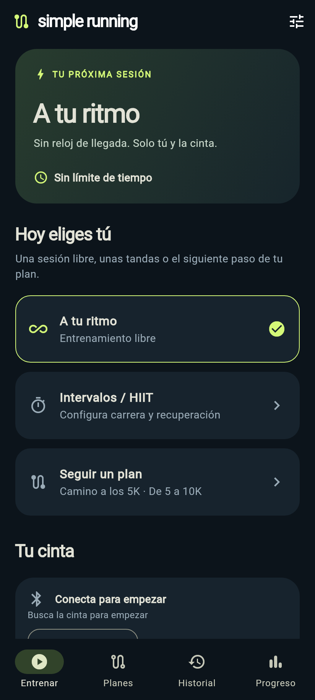

# SimpleRunning

Treadmill training at your own pace. An Android app with free workouts,
intervals, and guided plans. No account, ads, or analytics.

**[Download APK](https://github.com/Mancuerna/simplerunning/releases/latest)**

  

## Features

- Train freely or set up running and recovery intervals.
- Follow progressive plans with voice cues and vibration alerts.
- Track speed, distance, and time over Bluetooth.
- Review your history and progress, and export your workouts.

Workouts are stored on your device. Install the APK, connect a compatible
treadmill, and choose your session. The app interface is currently in Spanish.

## License

[MIT](LICENSE).
